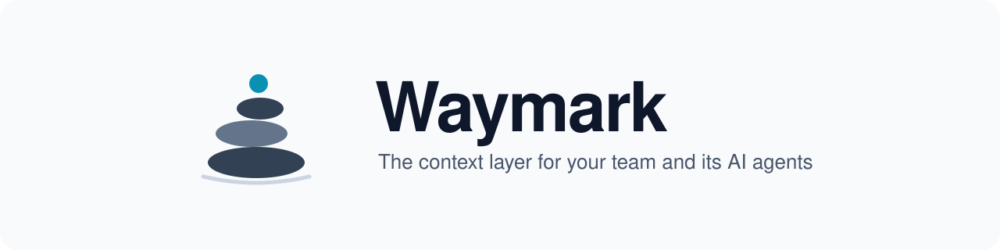
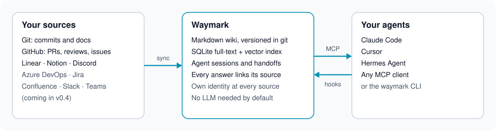

<p align="center">
  <picture>
    <source media="(prefers-color-scheme: dark)" srcset="docs/media/banner-dark.svg">
    
  </picture>
</p>

<h3 align="center">Ask "why is it built this way?" and get the PR, the issue and the commit that answer it.</h3>

<p align="center">
  Waymark is the open-source, self-hosted memory for your team and its AI agents. It turns your repos,<br>
  trackers, docs and chats into one searchable, source-linked knowledge base. Next, it will run AI teammates<br>
  that work from that knowledge, on the agent runtime you already have.
</p>

<p align="center">
  <a href="#quick-start"><b>Quick start</b></a> · <a href="docs/mcp.md">MCP server</a> · <a href="docs/claude-code.md">Claude Code</a> · <a href="docs/cursor.md">Cursor</a> · <a href="docs/hermes.md">Hermes</a> · <a href="docs/docker.md">Docker</a>
</p>

<p align="center">
  <a href="https://github.com/AlanEdward19/waymark/actions/workflows/ci.yml"></a>
  <a href="LICENSE"></a>
  
  
  
</p>

<p align="center">
  
</p>
<p align="center"><sub>Real output of <code>waymark sync</code> and <code>waymark search</code> on this repository, trimmed for width.</sub></p>

## Why

AI agents are only as good as the context they get.

- Code-intelligence tools know **what** the code is.
- Agent platforms know **how** to run an agent.
- The **why** lives in PR reviews, issue threads, design docs, incidents and chat. So does who owns which system, and how data flows from one service to the next. Most of that never reaches the agent, or the new hire.

Waymark collects that knowledge and keeps it as plain markdown you own. It serves it back to people and agents, with a link to where every fact came from.

<p align="center">
  <picture>
    <source media="(prefers-color-scheme: dark)" srcset="docs/media/how-it-works-dark.svg">
    
  </picture>
</p>

## What you get today

- **One search across sources.** Commits and repo docs, GitHub PRs, reviews and issues, Linear, Jira, Notion, Discord and Azure DevOps work items today; Azure DevOps pull requests, Confluence, Slack and Teams are next ([#20](https://github.com/AlanEdward19/waymark/issues/20)).
- **Answers with receipts.** Every hit links back to the commit, PR, issue or page it came from.
- **Memory for your agents.** Hooks capture Claude Code, Cursor and Hermes sessions, and a new session starts with what the last one learned. Agents can leave a handoff that exactly one later session claims.
- **Plain files you own.** The wiki is markdown in a git repository; the SQLite index (full-text plus optional vectors) is rebuildable at any time with `waymark reindex`.
- **No LLM required.** Sync, search, capture and handoffs work offline with zero API keys. Semantic search is an opt-in upgrade with any OpenAI-compatible embeddings endpoint, including a local one ([docs/search.md](docs/search.md)). An optional OpenAI-compatible `llm` for text generation stays optional too ([docs/memory.md](docs/memory.md)).
- **Its own identity.** Waymark reads each source as its own app or service account, never as you ([ADR-0002](docs/adr/0002-own-identity.md), [setup per source](docs/identities.md)).
- **Who touched what.**
  - Every commit, PR and repo doc is indexed with the files it touches and who touched them, as authors, reviewers and commenters.
  - One person is recognised across git names, logins and chat names ([docs/memory.md](docs/memory.md)).
- **Ready for a team.**
  - Users, groups, linked chat identities and API tokens, with only token hashes stored ([ADR-0003](docs/adr/0003-team-server.md)).
  - A chat-bot runtime with user mapping and rate limits ([docs/bots.md](docs/bots.md)).

## Where it is going: AI teammates

A teammate is an AI agent your team configures in Waymark, starts from a chat mention or the CLI, and points at a playbook. Here is an example.

> Someone notices that a day of currency data is blank and mentions the bot in Teams. The teammate uses the system map to see that the data comes from service X, which is fed by CDC replication from another database. It works through the chain:
>
> 1. It checks the API, the service database and the source database, and finds the gap in the replication.
> 2. It reads the CDC project's logs and code, and finds the commit that introduced the bug.
> 3. It replies in the thread with the evidence, or files a card for a human with the full write-up.

**What Waymark provides:**

- the teammate's identity;
- the triggers;
- playbooks with stages, budgets and routing;
- the knowledge;
- a default-deny, audited gateway to your tools;
- structured verdicts that must cite real evidence.

**What stays with you:**

- the agent itself (Claude Code, Hermes Agent or any CLI agent), on your own machine or VM, through pull-only runners that need no inbound port;
- your model keys;
- your sandbox;
- your infrastructure.

Waymark never runs model-generated code itself. The design is [ADR-0004](https://github.com/AlanEdward19/waymark/pull/115) and the work is tracked in [#116](https://github.com/AlanEdward19/waymark/issues/116). The first phase is investigate-and-report. Proposing fixes as pull requests comes later.

### How Waymark fits an agentic factory

| Layer | What it needs | Waymark |
|---|---|---|
| Brain | Code, docs and decisions, the same for people and agents | ✅ today: connectors, hybrid search, MCP, hooks, handoffs, path facts |
| Identity | Apps and bots that act as the system, not as a person | ✅ today: own identity per source, users and tokens |
| Work intake | Chat mentions, trackers, alerts | 🚧 chat bots ([#19](https://github.com/AlanEdward19/waymark/issues/19)) |
| Control | Playbook contract, dispatch, routing | 🔜 teammates ([#116](https://github.com/AlanEdward19/waymark/issues/116)) |
| Execution | Agent runtime, sandbox, tools | Yours. Waymark plugs in through runners and a tool gateway ([#116](https://github.com/AlanEdward19/waymark/issues/116)) |
| Quality | Evidence-checked verdicts, audit, evals | 🔜 verdicts and audit ([#116](https://github.com/AlanEdward19/waymark/issues/116), [#94](https://github.com/AlanEdward19/waymark/issues/94)); evals later |

Waymark is meant to sit alongside the tools you already use:

- **MCP servers.** Any of them, including code-search and code-intelligence servers, can become a teammate tool behind the gateway.
- **Agent platforms.** Any platform that speaks MCP can use Waymark as its memory.

## Quick start

Node 24 is required. The package is not on npm yet.

```bash
git clone https://github.com/AlanEdward19/waymark && cd waymark
npm ci && npm run build && npm link
waymark init                      # creates ~/.waymark (config, wiki, index)
```

Add sources to `~/.waymark/config.json`:

```json
{
  "version": 1,
  "sources": [
    { "id": "my-repo", "type": "git", "path": "C:/code/my-repo" },
    { "id": "my-repo-gh", "type": "github", "repo": "me/my-repo", "auth": "personal" }
  ]
}
```

Then sync and ask:

```bash
GITHUB_TOKEN=$(gh auth token) waymark sync
waymark search "why sqlite"
```

`auth: "personal"` is the quickest way to try it. For real use, give Waymark its own identity ([docs/identities.md](docs/identities.md)).

### Connect your agent

```bash
claude mcp add waymark -- waymark mcp
```

That gives Claude Code the `search`, `get_document`, `save_note` and handoff tools. Add the lifecycle hooks to capture sessions as well: [Claude Code](docs/claude-code.md) · [Cursor](docs/cursor.md) · [Hermes Agent](docs/hermes.md) · [any MCP client](docs/mcp.md).

## Sources

| Source                   | `type`         | What is ingested                                                          | Identity                       |
| ------------------------ | -------------- | ------------------------------------------------------------------------- | ------------------------------ |
| Git repository           | `git`          | Commits and markdown docs (`include: ["commits", "docs"]`)                | Local checkout                 |
| GitHub                   | `github`       | PRs with reviews, issues with comments                                    | GitHub App                     |
| Linear                   | `linear`       | Issues and comments                                                       | OAuth app (client credentials) |
| Jira Cloud               | `jira`         | Issues and comments (`project` or `jql`)                                  | Atlassian service account      |
| Notion                   | `notion`       | Pages shared with the integration                                         | Internal integration           |
| Discord                  | `discord`      | Messages of configured channels, one doc per channel per day              | Bot                            |
| Azure DevOps             | `azure-devops` | Work items and comments                                                   | Entra app identity             |
| Confluence, Slack, Teams |                | In progress, see [#20](https://github.com/AlanEdward19/waymark/issues/20) |                                |

Secrets never go in `config.json`; they come from environment variables listed per source in [docs/identities.md](docs/identities.md). `auth: "personal"` (development only) uses a personal token where the source supports it and logs a warning.

<details>
<summary>All commands</summary>

| Command                                  | What it does                                                                                                      |
| ---------------------------------------- | ----------------------------------------------------------------------------------------------------------------- |
| `waymark init`                           | Create `$WAYMARK_HOME` (default `~/.waymark`) with `config.json`, `wiki/` and `db/`                               |
| `waymark sync [--source <id>]`           | Pull new and changed documents from every source (or one)                                                         |
| `waymark search "<query>"`               | Ranked, source-linked results                                                                                     |
| `waymark show <id>`                      | Print one document                                                                                                |
| `waymark embed`                          | Embed new or changed documents (when `embeddings` is configured)                                                  |
| `waymark reindex`                        | Rebuild the index from the markdown wiki                                                                          |
| `waymark mcp`                            | MCP server over stdio                                                                                             |
| `waymark hook <harness>`                 | Lifecycle hook handler for `claude-code`, `cursor` or `hermes`                                                    |
| `waymark llm test`                       | Check the optional `llm` setup (see [docs/memory.md](docs/memory.md))                                             |
| `waymark people [--json]`                | List person names seen in the index, grouped by canonical name (see `people` in [docs/memory.md](docs/memory.md)) |
| `waymark user ...` / `waymark token ...` | Manage users, groups, linked identities and API tokens (see [docs/server.md](docs/server.md))                     |
| `waymark bot test <platform> ...`        | Run the chat-bot pipeline with a console adapter (see [docs/bots.md](docs/bots.md))                               |

</details>

## Roadmap

- ✅ MVP: git and GitHub ingest, markdown wiki, full-text search, MCP server
- ✅ Hybrid retrieval: embeddings, rank fusion, recency ([#15](https://github.com/AlanEdward19/waymark/issues/15))
- ✅ Agent hooks and handoffs for Claude Code, Cursor and Hermes ([#17](https://github.com/AlanEdward19/waymark/issues/17))
- 🚧 More connectors with Waymark's own identity ([#20](https://github.com/AlanEdward19/waymark/issues/20)), validated against real accounts ([#77](https://github.com/AlanEdward19/waymark/issues/77))
- 🚧 Organisational memory ([#16](https://github.com/AlanEdward19/waymark/issues/16)): path facts and people aliases shipped; expertise map, conventions and conflict-aware ranking next
- 🚧 Permissions, auth and remote access ([#18](https://github.com/AlanEdward19/waymark/issues/18)): users and tokens shipped; team server, audit and access control next
- 🚧 Chat bots ([#19](https://github.com/AlanEdward19/waymark/issues/19)): runtime shipped; Teams, Slack, Discord, GitHub and Linear next
- 🔜 AI teammates on your own runtime ([#116](https://github.com/AlanEdward19/waymark/issues/116), [ADR-0004](https://github.com/AlanEdward19/waymark/pull/115))

Waymark is self-hosted and model-agnostic. It works with no LLM at all, it never trains on your data, and it never runs your agents' code: your runtime does.

## Documentation

[Search and ranking](docs/search.md) · [Organisational memory](docs/memory.md) · [MCP server](docs/mcp.md) · [Claude Code](docs/claude-code.md) · [Cursor](docs/cursor.md) · [Hermes Agent](docs/hermes.md) · [Docker](docs/docker.md) · [Identities per source](docs/identities.md) · [Team server: users and tokens](docs/server.md) · [Chat bots](docs/bots.md) · [ADR-0001 stack](docs/adr/0001-stack.md) · [ADR-0002 own identity](docs/adr/0002-own-identity.md) · [ADR-0003 team server](docs/adr/0003-team-server.md) · [ADR-0004 teammates](docs/adr/0004-teammates.md)

## Contributing

Issues and pull requests are welcome. Read [CONTRIBUTING.md](CONTRIBUTING.md), open an issue to discuss bigger ideas first, and report vulnerabilities privately ([SECURITY.md](SECURITY.md)). `npm run check` (lint, types, tests) must pass.

## License

[MIT](LICENSE)
