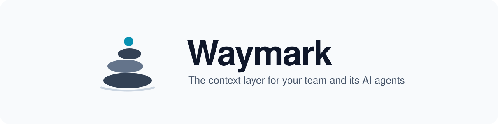
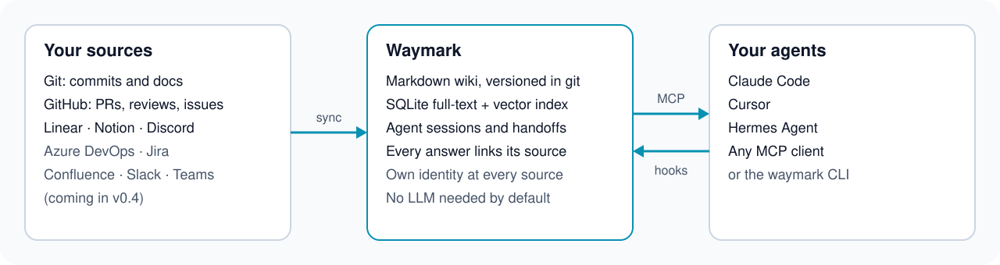

<p align="center">
  <picture>
    <source media="(prefers-color-scheme: dark)" srcset="docs/media/banner-dark.svg">
    
  </picture>
</p>

<h3 align="center">Ask "why is it built this way?" and get the PR, the issue and the commit that answer it.</h3>

<p align="center">
  An open-source, self-hosted context layer that turns your repos, trackers, docs and chats into one<br>
  searchable, source-linked memory for your team and its AI coding agents.
</p>

<p align="center">
  <a href="#quick-start"><b>Quick start</b></a> · <a href="docs/mcp.md">MCP server</a> · <a href="docs/claude-code.md">Claude Code</a> · <a href="docs/cursor.md">Cursor</a> · <a href="docs/hermes.md">Hermes</a> · <a href="docs/docker.md">Docker</a>
</p>

<p align="center">
  <a href="https://github.com/AlanEdward19/waymark/actions/workflows/ci.yml"></a>
  <a href="LICENSE"></a>
  
  
  
</p>

<p align="center">
  
</p>
<p align="center"><sub>Real output of <code>waymark sync</code> and <code>waymark search</code> on this repository, trimmed for width.</sub></p>

## Why

AI coding agents are only as good as the context they get. The reasons behind your code live in PR reviews, issue threads, design docs and chat, and most of it never reaches the agent, or the new teammate. Waymark collects it, keeps it as plain markdown you own, and serves it back with a link to where every fact came from.

<p align="center">
  <picture>
    <source media="(prefers-color-scheme: dark)" srcset="docs/media/how-it-works-dark.svg">
    
  </picture>
</p>

## What you get

- **One search across sources.** Commits and repo docs, GitHub PRs, reviews and issues, Linear, Notion and Discord today; Azure DevOps, Jira, Confluence, Slack and Teams are next ([#20](https://github.com/AlanEdward19/waymark/issues/20)).
- **Answers with receipts.** Every hit links back to the commit, PR, issue or page it came from.
- **Memory for your agents.** Hooks capture Claude Code, Cursor and Hermes sessions, and a new session starts with what the last one learned. Agents can leave a handoff that exactly one later session claims.
- **Plain files you own.** The wiki is markdown in a git repository; the SQLite index (full-text plus optional vectors) is rebuildable at any time with `waymark reindex`.
- **No LLM required.** Sync, search, capture and handoffs work offline with zero API keys. Semantic search is an opt-in upgrade with any OpenAI-compatible embeddings endpoint, including a local one ([docs/search.md](docs/search.md)).
- **Its own identity.** Waymark reads each source as its own app or service account, never as you ([ADR-0002](docs/adr/0002-own-identity.md), [setup per source](docs/identities.md)).

## Quick start

Node 24 is required. The package is not on npm yet.

```bash
git clone https://github.com/AlanEdward19/waymark && cd waymark
npm ci && npm run build && npm link
waymark init                      # creates ~/.waymark (config, wiki, index)
```

Add sources to `~/.waymark/config.json`:

```json
{
  "version": 1,
  "sources": [
    { "id": "my-repo", "type": "git", "path": "C:/code/my-repo" },
    { "id": "my-repo-gh", "type": "github", "repo": "me/my-repo", "auth": "personal" }
  ]
}
```

Then sync and ask:

```bash
GITHUB_TOKEN=$(gh auth token) waymark sync
waymark search "why sqlite"
```

`auth: "personal"` is the quickest way to try it. For real use, give Waymark its own identity ([docs/identities.md](docs/identities.md)).

### Connect your agent

```bash
claude mcp add waymark -- waymark mcp
```

That gives Claude Code the `search`, `get_document`, `save_note` and handoff tools. Add the lifecycle hooks to capture sessions as well: [Claude Code](docs/claude-code.md) · [Cursor](docs/cursor.md) · [Hermes Agent](docs/hermes.md) · [any MCP client](docs/mcp.md).

## Sources

| Source                                       | `type`    | What is ingested                                                          | Identity                       |
| -------------------------------------------- | --------- | ------------------------------------------------------------------------- | ------------------------------ |
| Git repository                               | `git`     | Commits and markdown docs (`include: ["commits", "docs"]`)                | Local checkout                 |
| GitHub                                       | `github`  | PRs with reviews, issues with comments                                    | GitHub App                     |
| Linear                                       | `linear`  | Issues and comments                                                       | OAuth app (client credentials) |
| Notion                                       | `notion`  | Pages shared with the integration                                         | Internal integration           |
| Discord                                      | `discord` | Messages of configured channels, one doc per channel per day              | Bot                            |
| Azure DevOps, Jira, Confluence, Slack, Teams |           | In progress, see [#20](https://github.com/AlanEdward19/waymark/issues/20) |                                |

Secrets never go in `config.json`; they come from environment variables listed per source in [docs/identities.md](docs/identities.md). `auth: "personal"` (development only) uses a personal token where the source supports it and logs a warning.

<details>
<summary>All commands</summary>

| Command                        | What it does                                                                        |
| ------------------------------ | ----------------------------------------------------------------------------------- |
| `waymark init`                 | Create `$WAYMARK_HOME` (default `~/.waymark`) with `config.json`, `wiki/` and `db/` |
| `waymark sync [--source <id>]` | Pull new and changed documents from every source (or one)                           |
| `waymark search "<query>"`     | Ranked, source-linked results                                                       |
| `waymark show <id>`            | Print one document                                                                  |
| `waymark embed`                | Embed new or changed documents (when `embeddings` is configured)                    |
| `waymark reindex`              | Rebuild the index from the markdown wiki                                            |
| `waymark mcp`                  | MCP server over stdio                                                               |
| `waymark hook <harness>`       | Lifecycle hook handler for `claude-code`, `cursor` or `hermes`                      |

</details>

## Roadmap

- ✅ MVP: git and GitHub ingest, markdown wiki, full-text search, MCP server
- ✅ Hybrid retrieval: embeddings, rank fusion, recency ([#15](https://github.com/AlanEdward19/waymark/issues/15))
- ✅ Agent hooks and handoffs for Claude Code, Cursor and Hermes ([#17](https://github.com/AlanEdward19/waymark/issues/17))
- 🚧 More connectors with Waymark's own identity ([#20](https://github.com/AlanEdward19/waymark/issues/20)), validated against real accounts ([#77](https://github.com/AlanEdward19/waymark/issues/77))
- 🚧 Optional local web portal for plug-and-play setup ([#81](https://github.com/AlanEdward19/waymark/issues/81))
- 🔜 Organisational memory: conventions, expertise, conflicts ([#16](https://github.com/AlanEdward19/waymark/issues/16))
- 🔜 Permissions, auth and remote access ([#18](https://github.com/AlanEdward19/waymark/issues/18))
- 🔜 Chat bots for Teams, Slack, Discord, GitHub and Linear ([#19](https://github.com/AlanEdward19/waymark/issues/19))

Waymark is not a hosted SaaS, not a chatbot and not an agent framework: it supplies context to the agents you already use. It never trains on your data.

## Documentation

[Search and ranking](docs/search.md) · [MCP server](docs/mcp.md) · [Claude Code](docs/claude-code.md) · [Cursor](docs/cursor.md) · [Hermes Agent](docs/hermes.md) · [Docker](docs/docker.md) · [Identities per source](docs/identities.md) · [ADR-0001 stack](docs/adr/0001-stack.md) · [ADR-0002 own identity](docs/adr/0002-own-identity.md)

## Contributing

Issues and pull requests are welcome. Read [CONTRIBUTING.md](CONTRIBUTING.md), open an issue to discuss bigger ideas first, and report vulnerabilities privately ([SECURITY.md](SECURITY.md)). `npm run check` (lint, types, tests) must pass.

## License

[MIT](LICENSE)
